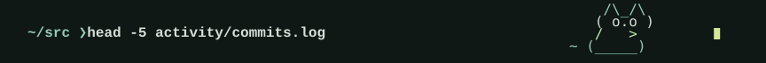
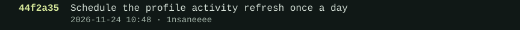
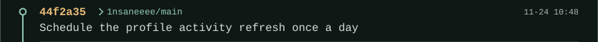
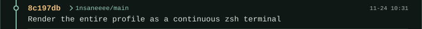
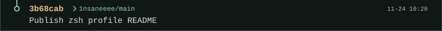

<picture><source media="(max-width: 600px) and (prefers-reduced-motion: reduce)" srcset="./assets/zsh-mobile.png"><source media="(prefers-reduced-motion: reduce)" srcset="./assets/zsh.png"><source media="(max-width: 600px)" srcset="./assets/zsh-mobile.gif"></picture><a href="./assets/terminal/stat.svg"><picture><source media="(max-width: 600px)" srcset="./assets/terminal/overview-mobile.svg"></picture></a><picture><source media="(max-width: 600px) and (prefers-reduced-motion: reduce)" srcset="./assets/terminal/log-mobile.svg"><source media="(prefers-reduced-motion: reduce)" srcset="./assets/terminal/log.svg"><source media="(max-width: 600px)" srcset="./assets/terminal/log-cat-mobile.svg"></picture><a href="https://github.com/1nsaneeee/1nsaneeee/commit/5392ff795c8e427cdf8f8c05c929b84abc989c23"><picture><source media="(max-width: 600px)" srcset="./assets/terminal/commit-1-mobile.svg"></picture></a><a href="https://github.com/1nsaneeee/1nsaneeee/commit/44f2a359b7ee748c538ad6d476a855ba4c207f01"><picture><source media="(max-width: 600px)" srcset="./assets/terminal/commit-2-mobile.svg"></picture></a><a href="https://github.com/1nsaneeee/1nsaneeee/commit/8c197db178f40a58fba3b13a762e0b94bc41986a"><picture><source media="(max-width: 600px)" srcset="./assets/terminal/commit-3-mobile.svg"></picture></a><a href="https://github.com/1nsaneeee/1nsaneeee/commit/3b68cab4e45d83e8720183f7108112dcbae85d2f"><picture><source media="(max-width: 600px)" srcset="./assets/terminal/commit-4-mobile.svg"></picture></a><a href="https://github.com/1nsaneeee/ftb-quests-preview/commit/3ebf0f5adb825ee8362dd4efe8a659b02f5cb3dc"><picture><source media="(max-width: 600px)" srcset="./assets/terminal/commit-5-mobile.svg"></picture></a><picture><source media="(max-width: 600px)" srcset="./assets/terminal/tree-mobile.svg"></picture><a href="https://github.com/1nsaneeee/ftb-quests-preview"><picture><source media="(max-width: 600px)" srcset="./assets/terminal/repo-ftb-quests-preview-mobile.svg"></picture></a><a href="https://github.com/1nsaneeee/url-to-markdown"><picture><source media="(max-width: 600px)" srcset="./assets/terminal/repo-url-to-markdown-mobile.svg"></picture></a><a href="https://github.com/1nsaneeee/fgo-np-calculator"><picture><source media="(max-width: 600px)" srcset="./assets/terminal/repo-fgo-np-calculator-mobile.svg"></picture></a><a href="https://github.com/1nsaneeee/Programming-Carrier"><picture><source media="(max-width: 600px)" srcset="./assets/terminal/repo-Programming-Carrier-mobile.svg"></picture></a><picture><source media="(max-width: 600px)" srcset="./assets/terminal/prompt-mobile.svg"></picture>

