<!--
  Oh My Zsh terminal profile for 1nsaneeee.
  Edit `coldjokeconfig`, `chaldeas/AGENTS.md`, or `Minecraft/SKILL.md` and push —
  GitHub Actions regenerates all Dark & Light SVG cards automatically.
-->

<picture>
  <source media="(prefers-color-scheme: dark)" srcset="./assets/terminal/banner-dark.svg">
  
</picture>

  <a href="https://github.com/1nsaneeee/agentinminecraft"><picture><source media="(prefers-color-scheme: dark)" srcset="./assets/badges/badge-agentinminecraft-dark.svg"></picture></a>&nbsp; <a href="https://github.com/1nsaneeee/OpenJarvis"><picture><source media="(prefers-color-scheme: dark)" srcset="./assets/badges/badge-openjarvis-dark.svg"></picture></a>&nbsp; <a href="https://1nsaneeee.github.io/fgo-np-calculator/"><picture><source media="(prefers-color-scheme: dark)" srcset="./assets/badges/badge-fgo-demo-dark.svg"></picture></a>&nbsp; <a href="https://1nsaneeee.github.io/pixart-pixel-tool/"><picture><source media="(prefers-color-scheme: dark)" srcset="./assets/badges/badge-pixart-demo-dark.svg"></picture></a>

<picture>
  <source media="(prefers-color-scheme: dark)" srcset="./assets/terminal/neofetch-dark.svg">
  
</picture>

### `➜ ~/projects` · Featured Builds

| Project | What it does | Stack | Links |
| :--- | :--- | :--- | :--- |
| **[agentinminecraft](https://github.com/1nsaneeee/agentinminecraft)** | NeoForge 1.21.1 Mod：MCP（35 工具）+ WebSocket 桥接，给 AI Agent 一具能在 MC 里走路、挖矿、造世界、聊天的真实玩家身体 | `Java` `MCP` | [Repo](https://github.com/1nsaneeee/agentinminecraft) |
| **[OpenJarvis](https://github.com/1nsaneeee/OpenJarvis)** | 本地优先、模型无关的开源桌面语音 AI 助手框架（唤醒词 → ASR → LLM → MCP 工具执行） | `Python` `MCP` | [Repo](https://github.com/1nsaneeee/OpenJarvis) |
| **[ftb-quests-preview](https://github.com/1nsaneeee/ftb-quests-preview)** | 本地 FTB Quests 任务书可视化预览编辑器 + Headless CLI（节点拖拽、格式码补全、AI JSON Patch） | `JS` `CLI` | [Repo](https://github.com/1nsaneeee/ftb-quests-preview) |
| **[fgo-np-calculator](https://github.com/1nsaneeee/fgo-np-calculator)** | FGO 宝具伤害计算器 v2.0：伤害区间、NP 回收、三回合周回连发试算 | `JS` `Web` | [Repo](https://github.com/1nsaneeee/fgo-np-calculator) · [**Demo**](https://1nsaneeee.github.io/fgo-np-calculator/) |
| **[url-to-markdown](https://github.com/1nsaneeee/url-to-markdown)** | VS Code 扩展：输入网址智能提取正文（Readability）并转换为干净的 Markdown | `TS` `VS Code` | [Repo](https://github.com/1nsaneeee/url-to-markdown) |
| **[Programming-Carrier](https://github.com/1nsaneeee/Programming-Carrier)** | Unity 2D 类银河战士恶魔城 RPG 毕业设计（战斗、探索、技能系统） | `C#` `Unity` | [Repo](https://github.com/1nsaneeee/Programming-Carrier) |
| **[pixart-pixel-tool](https://github.com/1nsaneeee/pixart-pixel-tool)** | 24×24 像素画参照工具：图片转 40 色限定像素网格，零依赖单文件 | `JS` `Canvas` | [Repo](https://github.com/1nsaneeee/pixart-pixel-tool) · [**Demo**](https://1nsaneeee.github.io/pixart-pixel-tool/) |
| **[doc-router](https://github.com/1nsaneeee/doc-router)** | Agent Skill：Context7 + `llms.txt` 文档检索路由管线 | `PS1` `Skill` | [Repo](https://github.com/1nsaneeee/doc-router) |

<picture>
  <source media="(prefers-color-scheme: dark)" srcset="./assets/terminal/skills-dark.svg">
  
</picture>

<picture>
  <source media="(prefers-color-scheme: dark)" srcset="https://skillicons.dev/icons?i=ts%2Cjs%2Cjava%2Cpy%2Ccs%2Cunity%2Cnodejs%2Cvscode%2Cgit%2Cgithub&amp;theme=dark">
  
</picture>

 

<a href="https://1nsaneeee.github.io/fgo-np-calculator/">
<picture>
  <source media="(prefers-color-scheme: dark)" srcset="./assets/terminal/chaldeas-dark.svg">
  
</picture>
</a>

<code>cat ~/chaldeas/AGENTS.md</code> · <a href="./chaldeas/AGENTS.md">御主档案源文件</a> · <a href="https://1nsaneeee.github.io/fgo-np-calculator/">在线打开宝具计算器</a> · <a href="https://github.com/1nsaneeee/fgo-np-calculator">源码仓库</a>

  

<a href="https://github.com/1nsaneeee/ftb-quests-preview">
<picture>
  <source media="(prefers-color-scheme: dark)" srcset="./assets/terminal/minecraft-dark.svg">
  
</picture>
</a>

<code>cat ~/Minecraft/SKILL.md</code> · <a href="./Minecraft/SKILL.md">任务手册源文件</a> · <a href="https://github.com/1nsaneeee/agentinminecraft">AI 进 MC 模组</a> · <a href="https://github.com/1nsaneeee/ftb-quests-preview">FTB 任务编辑器</a>

  

<picture>
  <source media="(prefers-color-scheme: dark)" srcset="./assets/terminal/shipped-dark.svg">
  
</picture>

