
<picture><source media="(max-width: 900px) and (prefers-reduced-motion: reduce)" srcset="./assets/terminal/desktop/region-0-still-mobile.svg"><source media="(prefers-reduced-motion: reduce)" srcset="./assets/terminal/desktop/region-0-still.svg"><source media="(max-width: 900px)" srcset="./assets/terminal/desktop/region-0-mobile.svg"></picture><a href="https://github.com/1nsaneeee/ftb-quests-preview"><picture><source media="(max-width: 900px) and (prefers-reduced-motion: reduce)" srcset="./assets/terminal/desktop/repo-0-still-mobile.svg"><source media="(prefers-reduced-motion: reduce)" srcset="./assets/terminal/desktop/repo-0-still.svg"><source media="(max-width: 900px)" srcset="./assets/terminal/desktop/repo-0-mobile.svg"></picture></a><a href="https://github.com/1nsaneeee/url-to-markdown"><picture><source media="(max-width: 900px) and (prefers-reduced-motion: reduce)" srcset="./assets/terminal/desktop/repo-1-still-mobile.svg"><source media="(prefers-reduced-motion: reduce)" srcset="./assets/terminal/desktop/repo-1-still.svg"><source media="(max-width: 900px)" srcset="./assets/terminal/desktop/repo-1-mobile.svg"></picture></a><a href="https://github.com/1nsaneeee/fgo-np-calculator"><picture><source media="(max-width: 900px) and (prefers-reduced-motion: reduce)" srcset="./assets/terminal/desktop/repo-2-still-mobile.svg"><source media="(prefers-reduced-motion: reduce)" srcset="./assets/terminal/desktop/repo-2-still.svg"><source media="(max-width: 900px)" srcset="./assets/terminal/desktop/repo-2-mobile.svg"></picture></a><a href="https://github.com/1nsaneeee/Programming-Carrier"><picture><source media="(max-width: 900px) and (prefers-reduced-motion: reduce)" srcset="./assets/terminal/desktop/repo-3-still-mobile.svg"><source media="(prefers-reduced-motion: reduce)" srcset="./assets/terminal/desktop/repo-3-still.svg"><source media="(max-width: 900px)" srcset="./assets/terminal/desktop/repo-3-mobile.svg"></picture></a><picture><source media="(max-width: 900px) and (prefers-reduced-motion: reduce)" srcset="./assets/terminal/desktop/region-4-still-mobile.svg"><source media="(prefers-reduced-motion: reduce)" srcset="./assets/terminal/desktop/region-4-still.svg"><source media="(max-width: 900px)" srcset="./assets/terminal/desktop/region-4-mobile.svg"></picture><a href="./assets/terminal/stat.svg"><picture><source media="(max-width: 900px) and (prefers-reduced-motion: reduce)" srcset="./assets/terminal/desktop/stats-still-mobile.svg"><source media="(prefers-reduced-motion: reduce)" srcset="./assets/terminal/desktop/stats-still.svg"><source media="(max-width: 900px)" srcset="./assets/terminal/desktop/stats-mobile.svg"></picture></a><picture><source media="(max-width: 900px) and (prefers-reduced-motion: reduce)" srcset="./assets/terminal/desktop/region-5-still-mobile.svg"><source media="(prefers-reduced-motion: reduce)" srcset="./assets/terminal/desktop/region-5-still.svg"><source media="(max-width: 900px)" srcset="./assets/terminal/desktop/region-5-mobile.svg"></picture><a href="https://github.com/1nsaneeee/1nsaneeee/commit/5e24d86f18f7096d267e90e5fabc9b6c5df07e6a"><picture><source media="(max-width: 900px) and (prefers-reduced-motion: reduce)" srcset="./assets/terminal/desktop/commit-0-still-mobile.svg"><source media="(prefers-reduced-motion: reduce)" srcset="./assets/terminal/desktop/commit-0-still.svg"><source media="(max-width: 900px)" srcset="./assets/terminal/desktop/commit-0-mobile.svg"></picture></a><a href="https://github.com/1nsaneeee/1nsaneeee/commit/1b85f42bc780fa7b04b9f4b15e686af491bab42c"><picture><source media="(max-width: 900px) and (prefers-reduced-motion: reduce)" srcset="./assets/terminal/desktop/commit-1-still-mobile.svg"><source media="(prefers-reduced-motion: reduce)" srcset="./assets/terminal/desktop/commit-1-still.svg"><source media="(max-width: 900px)" srcset="./assets/terminal/desktop/commit-1-mobile.svg"></picture></a><a href="https://github.com/1nsaneeee/1nsaneeee/commit/a72d3056f377786887d97c60faf6f4f5af1c435b"><picture><source media="(max-width: 900px) and (prefers-reduced-motion: reduce)" srcset="./assets/terminal/desktop/commit-2-still-mobile.svg"><source media="(prefers-reduced-motion: reduce)" srcset="./assets/terminal/desktop/commit-2-still.svg"><source media="(max-width: 900px)" srcset="./assets/terminal/desktop/commit-2-mobile.svg"></picture></a><a href="https://github.com/1nsaneeee/1nsaneeee/commit/b6757f5d66d36a64200321cf9c9ba526818a350b"><picture><source media="(max-width: 900px) and (prefers-reduced-motion: reduce)" srcset="./assets/terminal/desktop/commit-3-still-mobile.svg"><source media="(prefers-reduced-motion: reduce)" srcset="./assets/terminal/desktop/commit-3-still.svg"><source media="(max-width: 900px)" srcset="./assets/terminal/desktop/commit-3-mobile.svg"></picture></a><a href="https://github.com/1nsaneeee/1nsaneeee/commit/5392ff795c8e427cdf8f8c05c929b84abc989c23"><picture><source media="(max-width: 900px) and (prefers-reduced-motion: reduce)" srcset="./assets/terminal/desktop/commit-4-still-mobile.svg"><source media="(prefers-reduced-motion: reduce)" srcset="./assets/terminal/desktop/commit-4-still.svg"><source media="(max-width: 900px)" srcset="./assets/terminal/desktop/commit-4-mobile.svg"></picture></a><picture><source media="(max-width: 900px) and (prefers-reduced-motion: reduce)" srcset="./assets/terminal/desktop/region-10-still-mobile.svg"><source media="(prefers-reduced-motion: reduce)" srcset="./assets/terminal/desktop/region-10-still.svg"><source media="(max-width: 900px)" srcset="./assets/terminal/desktop/region-10-mobile.svg"></picture>

