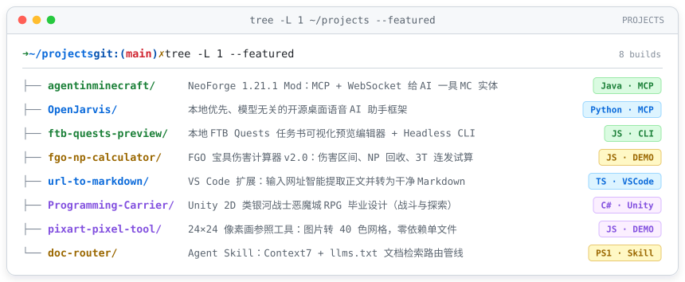
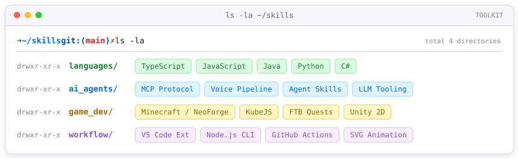

<!--
  Oh My Zsh terminal profile for 1nsaneeee.
  Edit `coldjokeconfig`, `chaldeas/AGENTS.md`, or `Minecraft/SKILL.md` and push —
  GitHub Actions regenerates all Dark & Light SVG cards automatically.
-->

<picture>
  <source media="(prefers-color-scheme: dark)" srcset="./assets/terminal/banner-dark.svg">
  
</picture>

  <a href="https://github.com/1nsaneeee/agentinminecraft"><picture><source media="(prefers-color-scheme: dark)" srcset="./assets/badges/badge-agentinminecraft-dark.svg"></picture></a>&nbsp; <a href="https://github.com/1nsaneeee/OpenJarvis"><picture><source media="(prefers-color-scheme: dark)" srcset="./assets/badges/badge-openjarvis-dark.svg"></picture></a>&nbsp; <a href="https://1nsaneeee.github.io/fgo-np-calculator/"><picture><source media="(prefers-color-scheme: dark)" srcset="./assets/badges/badge-fgo-demo-dark.svg"></picture></a>&nbsp; <a href="https://1nsaneeee.github.io/pixart-pixel-tool/"><picture><source media="(prefers-color-scheme: dark)" srcset="./assets/badges/badge-pixart-demo-dark.svg"></picture></a>

<picture>
  <source media="(prefers-color-scheme: dark)" srcset="./assets/terminal/neofetch-dark.svg">
  
</picture>

<picture>
  <source media="(prefers-color-scheme: dark)" srcset="./assets/terminal/projects-dark.svg">
  
</picture>

<code>cd ~/projects</code> · <a href="https://github.com/1nsaneeee/agentinminecraft">agentinminecraft</a> · <a href="https://github.com/1nsaneeee/OpenJarvis">OpenJarvis</a> · <a href="https://github.com/1nsaneeee/ftb-quests-preview">ftb-quests-preview</a> · <a href="https://github.com/1nsaneeee/fgo-np-calculator">fgo-np-calculator</a> (<a href="https://1nsaneeee.github.io/fgo-np-calculator/">Demo</a>) · <a href="https://github.com/1nsaneeee/url-to-markdown">url-to-markdown</a> · <a href="https://github.com/1nsaneeee/Programming-Carrier">Programming-Carrier</a> · <a href="https://github.com/1nsaneeee/pixart-pixel-tool">pixart-pixel-tool</a> (<a href="https://1nsaneeee.github.io/pixart-pixel-tool/">Demo</a>) · <a href="https://github.com/1nsaneeee/doc-router">doc-router</a>

  

<picture>
  <source media="(prefers-color-scheme: dark)" srcset="./assets/terminal/skills-dark.svg">
  
</picture>

<picture>
  <source media="(prefers-color-scheme: dark)" srcset="https://skillicons.dev/icons?i=ts%2Cjs%2Cjava%2Cpy%2Ccs%2Cunity%2Cnodejs%2Cvscode%2Cgit%2Cgithub&amp;theme=dark">
  
</picture>

  

<a href="https://1nsaneeee.github.io/fgo-np-calculator/">
<picture>
  <source media="(prefers-color-scheme: dark)" srcset="./assets/terminal/chaldeas-dark.svg">
  
</picture>
</a>

<code>cat ~/chaldeas/AGENTS.md</code> · <a href="./chaldeas/AGENTS.md">御主档案源文件</a> · <a href="https://1nsaneeee.github.io/fgo-np-calculator/">在线打开宝具计算器</a> · <a href="https://github.com/1nsaneeee/fgo-np-calculator">源码仓库</a>

  

<a href="https://github.com/1nsaneeee/ftb-quests-preview">
<picture>
  <source media="(prefers-color-scheme: dark)" srcset="./assets/terminal/minecraft-dark.svg">
  
</picture>
</a>

<code>cat ~/Minecraft/SKILL.md</code> · <a href="./Minecraft/SKILL.md">任务手册源文件</a> · <a href="https://github.com/1nsaneeee/agentinminecraft">AI 进 MC 模组</a> · <a href="https://github.com/1nsaneeee/ftb-quests-preview">FTB 任务编辑器</a>

  

<picture>
  <source media="(prefers-color-scheme: dark)" srcset="./assets/terminal/shipped-dark.svg">
  
</picture>

