
<picture><source media="(max-width: 600px) and (prefers-reduced-motion: reduce)" srcset="./assets/terminal/pane-identity-still-mobile.svg"><source media="(prefers-reduced-motion: reduce)" srcset="./assets/terminal/pane-identity-still.svg"><source media="(max-width: 600px)" srcset="./assets/terminal/pane-identity-mobile.svg">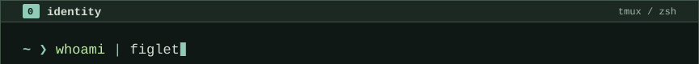</picture><picture><source media="(max-width: 600px) and (prefers-reduced-motion: reduce)" srcset="./assets/wordmark-mobile.png"><source media="(prefers-reduced-motion: reduce)" srcset="./assets/wordmark.png"><source media="(max-width: 600px)" srcset="./assets/wordmark-mobile.gif">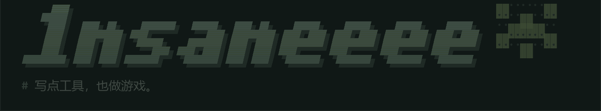</picture>

<picture><source media="(max-width: 600px) and (prefers-reduced-motion: reduce)" srcset="./assets/terminal/pane-profile-still-mobile.svg"><source media="(prefers-reduced-motion: reduce)" srcset="./assets/terminal/pane-profile-still.svg"><source media="(max-width: 600px)" srcset="./assets/terminal/pane-profile-mobile.svg">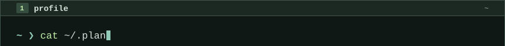</picture><picture><source media="(max-width: 600px) and (prefers-reduced-motion: reduce)" srcset="./assets/terminal/bio-mobile.svg"><source media="(prefers-reduced-motion: reduce)" srcset="./assets/terminal/bio.svg"><source media="(max-width: 600px)" srcset="./assets/terminal/bio-print-mobile.svg">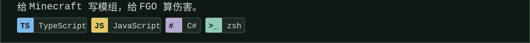</picture>

<picture><source media="(max-width: 600px) and (prefers-reduced-motion: reduce)" srcset="./assets/terminal/pane-activity-still-mobile.svg"><source media="(prefers-reduced-motion: reduce)" srcset="./assets/terminal/pane-activity-still.svg"><source media="(max-width: 600px)" srcset="./assets/terminal/pane-activity-mobile.svg">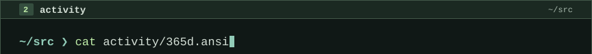</picture><a href="./assets/terminal/stat.svg"><picture><source media="(max-width: 600px) and (prefers-reduced-motion: reduce)" srcset="./assets/terminal/overview-mobile.svg"><source media="(prefers-reduced-motion: reduce)" srcset="./assets/terminal/overview.svg"><source media="(max-width: 600px)" srcset="./assets/terminal/overview-print-mobile.svg">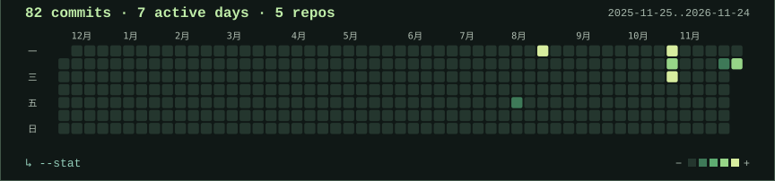</picture></a>

<picture><source media="(max-width: 600px) and (prefers-reduced-motion: reduce)" srcset="./assets/terminal/pane-commits-still-mobile.svg"><source media="(prefers-reduced-motion: reduce)" srcset="./assets/terminal/pane-commits-still.svg"><source media="(max-width: 600px)" srcset="./assets/terminal/pane-commits-mobile.svg">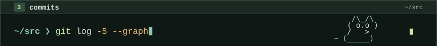</picture><a href="https://github.com/1nsaneeee/1nsaneeee/commit/a72d3056f377786887d97c60faf6f4f5af1c435b"><picture><source media="(max-width: 600px) and (prefers-reduced-motion: reduce)" srcset="./assets/terminal/commit-1-mobile.svg"><source media="(prefers-reduced-motion: reduce)" srcset="./assets/terminal/commit-1.svg"><source media="(max-width: 600px)" srcset="./assets/terminal/commit-1-print-mobile.svg">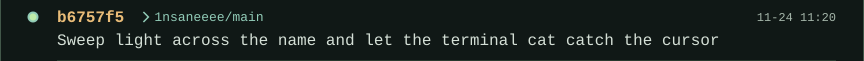</picture></a><a href="https://github.com/1nsaneeee/1nsaneeee/commit/b6757f5d66d36a64200321cf9c9ba526818a350b"><picture><source media="(max-width: 600px) and (prefers-reduced-motion: reduce)" srcset="./assets/terminal/commit-2-mobile.svg"><source media="(prefers-reduced-motion: reduce)" srcset="./assets/terminal/commit-2.svg"><source media="(max-width: 600px)" srcset="./assets/terminal/commit-2-print-mobile.svg"></picture></a><a href="https://github.com/1nsaneeee/1nsaneeee/commit/5392ff795c8e427cdf8f8c05c929b84abc989c23"><picture><source media="(max-width: 600px) and (prefers-reduced-motion: reduce)" srcset="./assets/terminal/commit-3-mobile.svg"><source media="(prefers-reduced-motion: reduce)" srcset="./assets/terminal/commit-3.svg"><source media="(max-width: 600px)" srcset="./assets/terminal/commit-3-print-mobile.svg">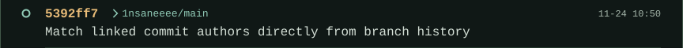</picture></a><a href="https://github.com/1nsaneeee/1nsaneeee/commit/44f2a359b7ee748c538ad6d476a855ba4c207f01"><picture><source media="(max-width: 600px) and (prefers-reduced-motion: reduce)" srcset="./assets/terminal/commit-4-mobile.svg"><source media="(prefers-reduced-motion: reduce)" srcset="./assets/terminal/commit-4.svg"><source media="(max-width: 600px)" srcset="./assets/terminal/commit-4-print-mobile.svg">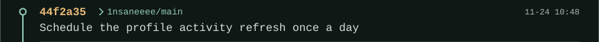</picture></a><a href="https://github.com/1nsaneeee/1nsaneeee/commit/8c197db178f40a58fba3b13a762e0b94bc41986a"><picture><source media="(max-width: 600px) and (prefers-reduced-motion: reduce)" srcset="./assets/terminal/commit-5-mobile.svg"><source media="(prefers-reduced-motion: reduce)" srcset="./assets/terminal/commit-5.svg"><source media="(max-width: 600px)" srcset="./assets/terminal/commit-5-print-mobile.svg">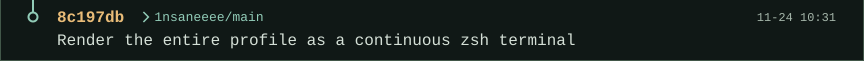</picture></a>

<picture><source media="(max-width: 600px) and (prefers-reduced-motion: reduce)" srcset="./assets/terminal/pane-repos-still-mobile.svg"><source media="(prefers-reduced-motion: reduce)" srcset="./assets/terminal/pane-repos-still.svg"><source media="(max-width: 600px)" srcset="./assets/terminal/pane-repos-mobile.svg">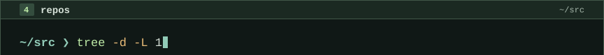</picture><a href="https://github.com/1nsaneeee/ftb-quests-preview"><picture><source media="(max-width: 600px) and (prefers-reduced-motion: reduce)" srcset="./assets/terminal/repo-ftb-quests-preview-mobile.svg"><source media="(prefers-reduced-motion: reduce)" srcset="./assets/terminal/repo-ftb-quests-preview.svg"><source media="(max-width: 600px)" srcset="./assets/terminal/repo-ftb-quests-preview-print-mobile.svg"></picture></a><a href="https://github.com/1nsaneeee/url-to-markdown"><picture><source media="(max-width: 600px) and (prefers-reduced-motion: reduce)" srcset="./assets/terminal/repo-url-to-markdown-mobile.svg"><source media="(prefers-reduced-motion: reduce)" srcset="./assets/terminal/repo-url-to-markdown.svg"><source media="(max-width: 600px)" srcset="./assets/terminal/repo-url-to-markdown-print-mobile.svg"></picture></a><a href="https://github.com/1nsaneeee/fgo-np-calculator"><picture><source media="(max-width: 600px) and (prefers-reduced-motion: reduce)" srcset="./assets/terminal/repo-fgo-np-calculator-mobile.svg"><source media="(prefers-reduced-motion: reduce)" srcset="./assets/terminal/repo-fgo-np-calculator.svg"><source media="(max-width: 600px)" srcset="./assets/terminal/repo-fgo-np-calculator-print-mobile.svg"></picture></a><a href="https://github.com/1nsaneeee/Programming-Carrier"><picture><source media="(max-width: 600px) and (prefers-reduced-motion: reduce)" srcset="./assets/terminal/repo-Programming-Carrier-mobile.svg"><source media="(prefers-reduced-motion: reduce)" srcset="./assets/terminal/repo-Programming-Carrier.svg"><source media="(max-width: 600px)" srcset="./assets/terminal/repo-Programming-Carrier-print-mobile.svg"></picture></a><picture><source media="(max-width: 600px)" srcset="./assets/terminal/prompt-mobile.svg"></picture>

