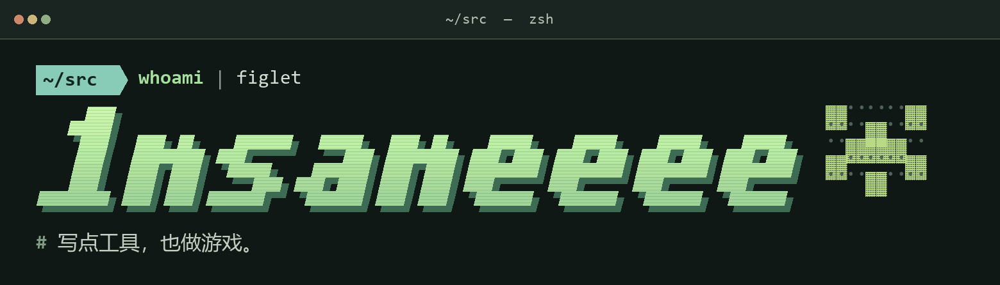
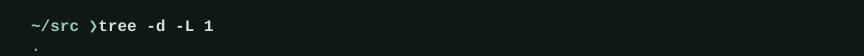

<picture><source media="(max-width: 600px)" srcset="./assets/zsh-mobile.png"></picture><a href="./assets/terminal/stat.svg"><picture><source media="(max-width: 600px)" srcset="./assets/terminal/overview-mobile.svg"></picture></a><picture><source media="(max-width: 600px)" srcset="./assets/terminal/log-mobile.svg"></picture><a href="https://github.com/1nsaneeee/agentinminecraft/commit/09c9096f777dab84bb6b9ada0a8116d14a874ff6"><picture><source media="(max-width: 600px)" srcset="./assets/terminal/commit-1-mobile.svg"></picture></a><a href="https://github.com/1nsaneeee/agentinminecraft/commit/269759731beec5660ddb441a6eca88b008a4d045"><picture><source media="(max-width: 600px)" srcset="./assets/terminal/commit-2-mobile.svg"></picture></a><a href="https://github.com/1nsaneeee/agentinminecraft/commit/fea784e9ab4cdf0f8438070d104a3e358b831149"><picture><source media="(max-width: 600px)" srcset="./assets/terminal/commit-3-mobile.svg"></picture></a><a href="https://github.com/1nsaneeee/agentinminecraft/commit/40bf16771aed2b56a7b6e253dfb4112b8ff74763"><picture><source media="(max-width: 600px)" srcset="./assets/terminal/commit-4-mobile.svg"></picture></a><a href="https://github.com/1nsaneeee/agentinminecraft/commit/e7357f8e7e64527df2ee4b2f21848df88d74b546"><picture><source media="(max-width: 600px)" srcset="./assets/terminal/commit-5-mobile.svg"></picture></a><picture><source media="(max-width: 600px)" srcset="./assets/terminal/tree-mobile.svg"></picture><a href="https://github.com/1nsaneeee/ftb-quests-preview"><picture><source media="(max-width: 600px)" srcset="./assets/terminal/repo-ftb-quests-preview-mobile.svg"></picture></a><a href="https://github.com/1nsaneeee/url-to-markdown"><picture><source media="(max-width: 600px)" srcset="./assets/terminal/repo-url-to-markdown-mobile.svg"></picture></a><a href="https://github.com/1nsaneeee/fgo-np-calculator"><picture><source media="(max-width: 600px)" srcset="./assets/terminal/repo-fgo-np-calculator-mobile.svg"></picture></a><a href="https://github.com/1nsaneeee/Programming-Carrier"><picture><source media="(max-width: 600px)" srcset="./assets/terminal/repo-Programming-Carrier-mobile.svg"></picture></a><picture><source media="(max-width: 600px)" srcset="./assets/terminal/prompt-mobile.svg"></picture>

