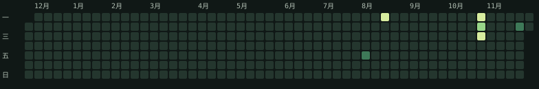

<picture>
  <source media="(max-width: 600px)" srcset="./assets/zsh-mobile.png">
  
</picture>

<pre><samp>~ ❯ cat ~/.plan
给 Minecraft 写模组，给 FGO 算伤害。
TypeScript / JavaScript / C#</samp></pre>

<!-- zsh-public-activity:start -->

<samp>~/src ❯ cat activity/365d.ansi</samp>

<samp>76 commits · 6 active days · 4 repos</samp>　2025-11-25..2026-11-24

<picture><source media="(max-width: 600px)" srcset="./assets/commits-27a72611f8-mobile.svg"></picture>

<samp>--stat</samp>

UTC+8 · 本人公开非 Fork 仓库的默认分支，按 GitHub 关联作者的提交日期统计。 每天提交数，从深到浅为 0 / 1 / 2–4 / 5–9 / 10+。

<pre>2026-11-17      1
2026-10-21     40
2026-10-20      5
2026-10-19     11
2026-08-10     18
2026-07-31      1</pre>

<samp>~/src ❯ head -5 activity/commits.log</samp>

<samp><a href="https://github.com/1nsaneeee/ftb-quests-preview/commit/3ebf0f5adb825ee8362dd4efe8a659b02f5cb3dc">3ebf0f5</a>　Release 0.1.3 with editor workflow and quest rendering fixes 2026-11-17 20:41 · ftb-quests-preview <a href="https://github.com/1nsaneeee/agentinminecraft/commit/09c9096f777dab84bb6b9ada0a8116d14a874ff6">09c9096</a>　Write the MC百科 listing in Chinese 2026-10-21 20:37 · agentinminecraft <a href="https://github.com/1nsaneeee/agentinminecraft/commit/269759731beec5660ddb441a6eca88b008a4d045">2697597</a>　Write the listing changelog in English 2026-10-21 20:25 · agentinminecraft <a href="https://github.com/1nsaneeee/agentinminecraft/commit/fea784e9ab4cdf0f8438070d104a3e358b831149">fea784e</a>　Release 0.3.2: follow, hand things over, and a build skill 2026-10-21 20:23 · agentinminecraft <a href="https://github.com/1nsaneeee/agentinminecraft/commit/40bf16771aed2b56a7b6e253dfb4112b8ff74763">40bf167</a>　Follow a player, and hand them things 2026-10-21 20:13 · agentinminecraft</samp>

<!-- zsh-public-activity:end -->

<pre><samp>~/src ❯ <b>tree</b> -d -L 1
.
├── <a href="https://github.com/1nsaneeee/ftb-quests-preview"><b>ftb-quests-preview/</b></a>
├── <a href="https://github.com/1nsaneeee/url-to-markdown"><b>url-to-markdown/</b></a>
├── <a href="https://github.com/1nsaneeee/fgo-np-calculator"><b>fgo-np-calculator/</b></a>
└── <a href="https://github.com/1nsaneeee/Programming-Carrier"><b>Programming-Carrier/</b></a>

~/src ❯ ▌</samp></pre>
